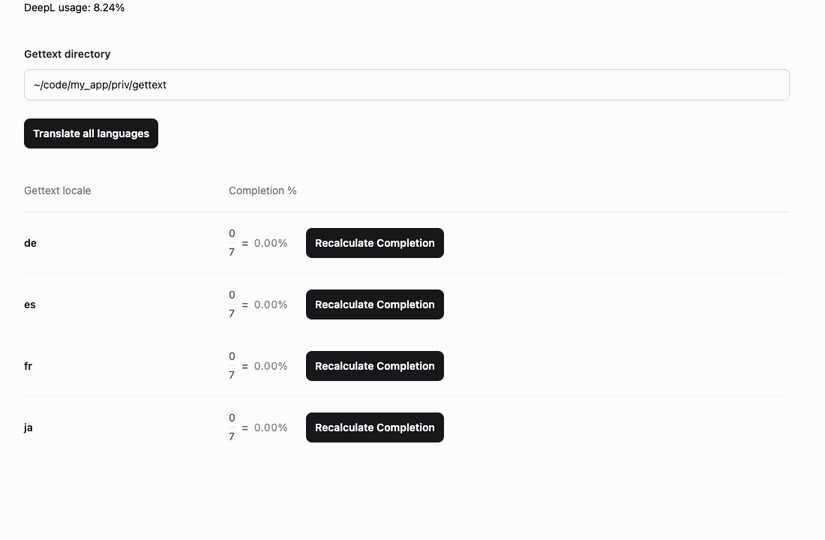

# Caint

Auto-translating of PO files for the lazy dev



## Features

- Bulk-translate locale-scoped PO files using [DeepL](https://developers.deepl.com/docs/api-reference/translate) 

- Translate *every* language in one click with "Translate all languages", with live progress.

- Failure-tolerant: DeepL throttling (HTTP 429), hiccups (5xx) and dropped connections are retried
  quietly with exponential backoff. If something still fails (e.g. quota exceeded), whatever *was*
  translated is saved and you are told what wasn't. Just run it again to pick up the rest.

- Plurals done properly: each plural form is translated with a real example number
  (e.g. `1 file`, `2 files`, `11 files`) so DeepL picks the right grammatical form,
  using the `Plural-Forms` header from your PO files.

- Your PO files stay tidy: message order, comments and headers are preserved,
  and nothing translated by hand is ever overwritten by the machine.


- Do single translations manually, using simple form input.

- See how "complete" a particular locale is.


- Easily find missing translations (they are at the top of a locale's page).


## What people are saying about Caint: 

> "Inefficient and hard to understand."

> "Better than nothing, I guess."

> "Please, dark mode. Please."

## First-time setup

```
mix setup
```

Then tell Caint about DeepL and your project, either with a file `config/dev_secrets.exs` (git-ignored) like this

```elixir
import Config

config :caint,
  deepl_api_key: "xxxxxxx",
  gettext_dir: "/home/my-project/priv/gettext",
  source_locale: "en"
```

or with environment variables: `DEEPL_API_KEY`, `GETTEXT_DIR`, `SOURCE_LOCALE`.

The DeepL API URL is worked out from the key (free-tier keys end in `:fx`), or can be set
with `deepl_api_url` / `DEEPL_API_URL`.

### Tuning

These are the defaults:

```elixir
config :caint,
  # DeepL requests in flight at once
  deepl_max_concurrency: 3,
  # Retries per request when throttled or on transient errors
  deepl_max_retries: 8,
  deepl_retry_base_delay_ms: 1_000,
  deepl_retry_max_delay_ms: 30_000
```

## Run it locally

```
iex -S mix phx.server
```

The default port is 4032, so visit `http://localhost:4032`.
